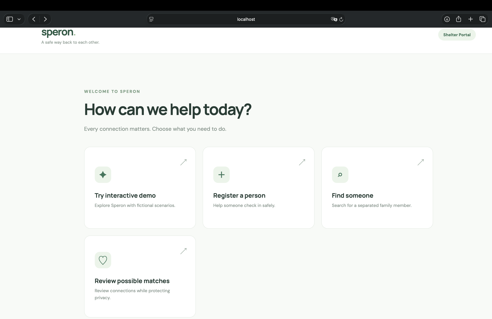
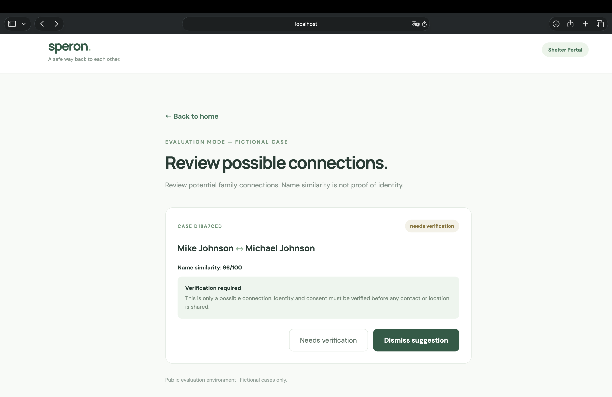

# Speron

*A safer way back to each other.*

**Live app:** https://unique-cascaron-a0bfe8.netlify.app  
**GitHub:** https://github.com/gulind/speron  
**Built for:** DALI Fullstack Challenge 26F — Reuniting Separated Families

## Overview

Speron is a prototype for helping separated family members find possible connections after a disaster. I focused on one part of the larger problem: what happens when someone searches for a family member, but the name they know doesn't exactly match the name recorded at a shelter?

During an evacuation, someone might be registered as Michael while their family searches for Mike. Names can also be misspelled, especially when volunteers are working quickly. I wanted to build a system that could recognize these possible matches without treating a similar name as proof of someone's identity.

Speron has three main steps: **register a person, search for someone, and review possible matches**. The deployed version uses fictional sample cases so people can try the workflow without entering real personal information.

## Screenshots





## What I built and why

I imagined a shelter volunteer trying to help someone who has lost their phone and doesn't have an ID. That person might only know a family member's nickname or approximate age. The volunteer needs something simple enough to use quickly, not a complicated search tool.

The local prototype lets a volunteer register a name or alias, an optional age group, a shelter location, and a few notes. A person can choose whether their record may be considered for matching. Someone looking for a family member can then submit a search, and staff can review suggested connections rather than having the app automatically reveal personal information.

The public site also has a guided demo and a database-backed evaluation flow using predefined fictional people. The general-purpose registration and search endpoints are kept out of the public deployment because the prototype does not yet have real staff authentication.

## How the matching works

This was the part I spent the most time thinking about. Exact string matching would miss people whose names were recorded a little differently, so I combined multiple approaches:

- **Levenshtein distance** for small spelling mistakes.
- **Jaro-Winkler similarity** for names with minor character differences.
- **Double Metaphone** for names that sound similar but are spelled differently.
- **Nickname groups** for cases such as Mike/Michael and Kate/Katherine.

In the local workflow, I also use a phonetic index in SQLite to find likely candidates before comparing their names. This avoids running the full comparison against every record.

I added an **optional approximate age-group filter** as another way to narrow a search. If the searched age group is unknown, it isn't used to exclude candidates. If an age group is provided, the current version filters out records with a different known age group. This makes some searches more specific, but it's also a tradeoff: ages can be guessed incorrectly during an emergency, so a real system should probably flag age disagreements for human review instead of ruling people out completely.

A match score is only a similarity measure, not a probability that two people are the same person. Even a very similar name can belong to someone else. That's why Speron has a review step instead of automatically confirming matches.

## People, privacy, and edge cases

I designed Speron mainly for shelter workers and volunteers, but the decisions they make affect people who may be scared, exhausted, or unable to provide much information. A few situations shaped my design:

- **No phone or ID:** volunteers can help someone register; the person doesn't need to sign in or provide documents.
- **Different names:** a nickname, spelling mistake, or phonetic variation shouldn't automatically end a search.
- **Missing information:** age is optional, and unknown or preferred names can be recorded.
- **False matches:** possible connections need human verification.
- **People who don't want to be found:** consent for matching is off by default in the local registration flow. A person who hasn't agreed to matching should not appear as a candidate.

The last point was especially important. Someone might have escaped an abusive situation or might not feel safe giving their real name. Finding a possible match should never automatically disclose a person's location to whoever is searching.

## The bigger picture

Speron is one part of a family reunification system, not the whole solution. In a real evacuation, shelters might have separate databases, paper sign-in sheets, limited internet access, and volunteers who rotate between shifts.

A complete system would need staff accounts and permissions, a safe way to digitize paper records, offline check-in with later synchronization, and shared records between authorized shelters. It would also need a careful process for confirming identities, asking for permission before connecting people, and recording when someone withdraws consent. I did not build those parts because I chose to spend the challenge on getting the matching-and-review idea working.

## Technical choices and tradeoffs

- **React + Vite:** for a straightforward interface with separate registration, search, and review screens.
- **Node.js + Express:** for API routes that connect the frontend to the backend.
- **SQLite (`node:sqlite`):** for storing records, searches, and review states without needing to set up a separate database service.
- **Netlify + Render:** to make the frontend and backend accessible through a live link.

My biggest tradeoff was **scope versus safety**. I wanted reviewers to try a real frontend/backend/database workflow, but exposing a public form for real names without authentication would be irresponsible. The live evaluation flow therefore accepts predefined fictional cases. The more flexible version is available in the local source code. The live evaluation routes use their own simplified case workflow, while the local search routes use the phonetic candidate index.

There are other limitations too. The current age filter is strict when two known age groups disagree, there is no production ready identity verification or staff authorization, and SQLite data on the free Render deployment may be lost after a restart. 

## Running locally

Node.js **24+** and npm are required.

```bash
git clone https://github.com/gulind/speron.git
cd speron/server
npm ci
NODE_ENV=development npm start
```

In another terminal:

```bash
cd speron/client
npm ci
npm run dev
```

Open `http://localhost:5173`. The local API runs on `http://localhost:3001`. Only use fictional data for testing.

For deployment, the frontend uses `VITE_API_URL` for the backend origin, and the backend uses `CLIENT_ORIGIN` for the frontend origin.

## AI usage

I used ChatGPT to help with implementing some features, debugging, and deployment. It was especially helpful when I got stuck with the frontend and backend integration. I tested the app and made adjustments as I went.

## What I'd improve next

I'd first add authenticated staff roles and better identity/consent verification. After that, I'd want to test the matching system on a wider variety of names, improve how it handles multi-part names and age uncertainty, and make the app usable across shelters when internet access is unreliable.
